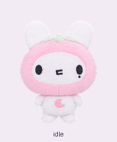

# Dalveny

以 Dalveny 兔子玩偶照片为参考制作的 ChatGPT Work 桌宠素材。

## 文件

- `Dalveny-sprites.png` 为透明精灵图，1536 × 2288 像素，8 列 × 11 行，每格 192 × 208 像素。
- `Dalveny.gif` 和 `Dalveny.mp4` 为九种状态的动画预览。
- `Dalveny-jump.gif` 和 `Dalveny-jump-frames.png` 展示起跳到落地。
- `Dalveny-look.gif` 和 `Dalveny-look-directions.png` 展示十六个视线方向。
- `Dalveny-contact-sheet.png` 展示全部帧。

## 动画布局

| 行（从 0 开始） | 状态 | 帧数 |
| --- | --- | --- |
| 0 | idle | 6 |
| 1 | running-right | 8 |
| 2 | running-left | 8 |
| 3 | waving | 4 |
| 4 | jumping | 5 |
| 5 | failed | 8 |
| 6 | waiting | 6 |
| 7 | running（专注工作） | 6 |
| 8 | review | 6 |
| 9 | 视线 000° 至 157.5° | 8 |
| 10 | 视线 180° 至 337.5° | 8 |

视线从正上方开始，按顺时针每 22.5° 一帧。标准状态行的剩余单元格透明。

## 使用说明

通过 Pets 插件导入精灵图并选为当前宠物。实际交互由 ChatGPT 客户端控制。2026-11-20 核对的 Windows 客户端版本中，悬停触发跳跃，拖动触发左右跑动，挥手用于首次欢迎。桌宠视线连接助手电脑操作光标和部分输入界面的光标位置，普通鼠标移动未直接连接到桌宠转头。

素材制作使用了 OpenAI 图像生成工具，并完成精灵图结构、透明背景、动作和视线检查。参考角色的原有权利归相应权利人所有。
